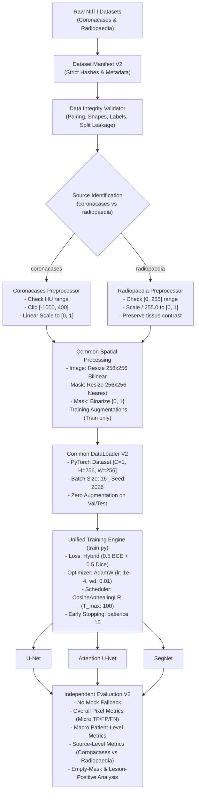

# V2 ARCHITECTURE SPECIFICATION
## Dual-Source Dataset Architecture | Lung Lesion Segmentation

- **Date:** 2026-11-23
- **Status:** Approved Target Architecture for Pipeline V2
- **Document:** `docs/migration/V2_ARCHITECTURE.md`

---

## 1. System Vision & Objective

Mục tiêu của Architecture V2 là giải quyết dứt điểm các lỗi nền tảng của Pipeline V1:
1. Xử lý triệt để sự không đồng nhất về dải cường độ giữa hai nguồn ảnh CT: **Coronacases** (HU-scale, `int16`) và **Radiopaedia** (Windowed/Screen-scale, `uint8 [0, 255]`).
2. Cung cấp cơ chế phân giải đường dẫn dữ liệu an toàn (**Safe Path Resolver**), loại bỏ hoàn toàn rủi ro fallback sai loại file và nhầm lẫn giữa CT và Mask.
3. Chuẩn hóa quy trình kiểm tra toàn vẹn dữ liệu (**Data Integrity Validation**) với khả năng phát hiện rò rỉ split, sai lệch nhãn và dữ liệu bất thường.
4. Thống nhất quy trình huấn luyện trên một **Unified Training Engine** duy nhất cho cả ba mô hình (U-Net, Attention U-Net, SegNet), đảm bảo tiêu chuẩn so sánh công bằng (**Fair Comparison**).
5. Thiết lập hệ thống đánh giá độc lập (**Evaluation V2**) tách bạch đa cấp độ: Overall, Patient-level, Source-level và Lesion/Non-lesion slice analysis.

---

## 2. End-to-End Target Architecture Diagram



---

## 3. Detailed Component Specifications

### 3.1. Source Identification Module (`src/data/v2/source_detector.py`)
Mục đích: Xác định chính xác nguồn gốc của volume dữ liệu mà không dựa vào thuộc tính ngẫu nhiên như dtype.
- **Quy tắc nhận diện:**
  1. Kiểm tra trường `source` trong manifest metadata nếu có.
  2. Phân tích tiền tố định danh mẫu / bệnh nhân:
     - `coronacases` hoặc `P_coronacases`: Nguồn `coronacases`.
     - `radiopaedia` hoặc `P_radiopaedia`: Nguồn `radiopaedia`.
  3. Kiểm tra cấu trúc đường dẫn file.
- **Xử lý ngoại lệ:** Nếu không khớp bất kỳ nguồn hợp lệ nào, lập tức ném `SourceIdentificationError`. Tuyệt đối không đoán định ngẫu nhiên.

### 3.2. Safe Path Resolver (`src/data/v2/resolver.py`)
Mục đích: Loại bỏ triệt để lỗi fallback trong V1.
- **Nguyên tắc an toàn:**
  1. **Strict Type Filtering:** File CT phải chứa từ khóa hợp lệ (`ct_volume`, `images`, `ct_vol`, v.v.) và tuyệt đối KHÔNG chứa từ khóa mask (`mask`, `infection`, `ground_truth`). Ngược lại, file Mask bắt buộc phải chứa từ khóa mask và không được nhầm sang CT.
  2. **Non-identity Enforcement:** `resolved_ct_path != resolved_mask_path`. Nếu hai đường dẫn trùng nhau, ném ngay `PathResolverError`.
  3. **No Unsafe Fallbacks:** Nếu danh sách ứng viên sau lọc bị rỗng, resolver **ném lỗi `FileNotFoundError` rõ ràng**, không được phép lấy `valid_matches[0]` của toàn bộ file tìm được.
  4. **Existence & Size Verification:** Kiểm tra `os.path.exists` và `os.path.getsize > 0`.

### 3.3. Source-Specific Preprocessing Module (`src/data/v2/preprocessing/`)

Cấu trúc module:
```text
src/data/v2/preprocessing/
├── __init__.py
├── base.py          # Abstract Base Class BasePreprocessor
├── coronacases.py   # CoronacasesPreprocessor (HU window [-1000, 400] -> [0, 1])
├── radiopaedia.py   # RadiopaediaPreprocessor (uint8 [0, 255] -> [0.0, 1.0])
├── common.py        # Common spatial transforms & mask binarization
└── registry.py      # PreprocessorRegistry
```

#### A. Coronacases Profile:
- **Tiêu chuẩn dữ liệu:** HU-scale. Dải giá trị quan sát thông thường: `[-1024, 3000+]`.
- **Quy trình:**
  1. Kiểm tra tính tương thích dải HU (`min < -200`, `max > 100`).
  2. Áp dụng Lung Windowing: `np.clip(image, -1000.0, 400.0)`.
  3. Min-Max Scaling: `norm = (clipped - (-1000.0)) / (400.0 - (-1000.0)) = (clipped + 1000.0) / 1400.0`.
  4. Đảm bảo dải `[0.0, 1.0]`, kiểu `float32`.

#### B. Radiopaedia Profile:
- **Tiêu chuẩn dữ liệu:** Đã được window sẵn từ nguồn web, lưu dưới dạng `uint8 [0, 255]`.
- **Quy trình:**
  1. Kiểm tra dải giá trị trong khoảng `[0, 255]`.
  2. Chuẩn hóa trực tiếp theo thang tỉ lệ tuyến tính: `norm = image.astype(np.float32) / 255.0`.
  3. Tuyệt đối không áp dụng HU window `[-1000, 400]` để tránh nén dải cường độ vào `[0.71, 0.90]`.
  4. Đảm bảo dải `[0.0, 1.0]`, kiểu `float32`.

#### C. Common Processing:
- Cặp ảnh `(image, mask)` sau tiền xử lý cường độ được resize đồng bộ về `(256, 256)`.
- Image nội suy `Bilinear` (`cv2.INTER_LINEAR` hoặc `F.interpolate` bilinear).
- Mask nội suy `Nearest Neighbor` (`cv2.INTER_NEAREST` hoặc `F.interpolate` nearest) để bảo toàn giá trị rời rạc.
- Mask Binarization: `(mask == lesion_label).astype(np.float32)`.

### 3.4. Manifest V2 Specification (`data/processed_v2/clean_slices_manifest_v2.csv`)
Các trường dữ liệu chuẩn của Manifest V2:
1. `sample_id` (str): Định danh duy nhất lát cắt (e.g. `P_coronacases_001_coronacases_001_z0085`).
2. `patient_id` (str): Định danh bệnh nhân (e.g. `P_coronacases_001`).
3. `source` (str): Nguồn dữ liệu (`coronacases` hoặc `radiopaedia`).
4. `volume_id` (str): Tên volume gốc.
5. `slice_index` (int): Chỉ số lát cắt trong volume (trục Z).
6. `original_shape` (str): Kích thước gốc (e.g. `512x512`).
7. `spacing_x`, `spacing_y`, `spacing_z` (float): Voxel spacing.
8. `lung_area_px` (int): Diện tích phổi tính bằng pixel.
9. `lesion_present` (int): 0 hoặc 1.
10. `lesion_area_px` (int): Diện tích tổn thương tính bằng pixel.
11. `source_volume_path` (str): Đường dẫn tương đối chuẩn của CT.
12. `source_mask_path` (str): Đường dẫn tương đối chuẩn của Mask.
13. `preprocessing_profile` (str): `coronacases_hu_window` hoặc `radiopaedia_direct_scale`.
14. `split` (str): `train`, `val`, hoặc `test`.
15. `qa_status` (str): Trạng thái QA (`PASSED`).

### 3.5. Data Integrity Validator (`src/data/v2/integrity.py`)
Công cụ chạy độc lập để xác thực toàn bộ dataset và manifest:
- Xác minh sự tồn tại của file và kiểm tra không rỗng (non-zero size).
- Xác minh CT và Mask không trỏ cùng một file (`path_ct != path_mask`).
- Kiểm tra tính hợp lệ của nhãn mask (`{0, 1}`).
- Kiểm tra không có giá trị bất thường (`NaN`, `Inf`).
- Xác minh tính đúng đắn của Patient-Level Split: Không có rò rỉ bệnh nhân giữa Train, Val và Test.
- Báo cáo thống kê chi tiết theo cả 2 nguồn và 3 tập split.

### 3.6. Unified Training Pipeline Integration (`train.py`)
- Cả ba mô hình (U-Net, Attention U-Net, SegNet) sử dụng chung engine `train.py`.
- Loại bỏ hoàn toàn `train_segnet.py` khỏi luồng thực thi chính (chuyển vào legacy archive hoặc deprecate).
- Tiêu chuẩn cấu hình đồng nhất:
  ```yaml
  image_size: [256, 256]
  batch_size: 16
  epochs: 100
  learning_rate: 0.0001
  weight_decay: 0.01
  optimizer: AdamW
  scheduler: CosineAnnealingLR
  early_stopping:
    patience: 15
  loss:
    name: hybrid
    bce_weight: 0.5
    dice_weight: 0.5
    smooth: 1e-5
  seed: 2026
  lesion_label: 1
  ```
- Checkpoint V2 metadata schema mở rộng:
  ```python
  {
      "experiment_id": "EXP-ATTUNET-002",
      "model_name": "AttentionUNet",
      "epoch": 24,
      "model_state_dict": model.state_dict(),
      "optimizer_state_dict": optimizer.state_dict(),
      "scheduler_state_dict": scheduler.state_dict(),
      "best_val_dice": 0.7852,
      "config": full_config_dict,
      "git_commit": "d6aad6c...",
      "data_manifest_sha256": "...",
      "split_sha256": "...",
      "preprocessing_version": "v2_dual_source",
      "seed": 2026
  }
  ```

### 3.7. Unified Independent Evaluation V2 (`src/evaluation/v2_evaluator.py`)
- **Strict Protocol:** Không sử dụng mock fallback. Báo lỗi và dừng nếu thiếu dữ liệu thật.
- **Đa tầng báo cáo:**
  1. **Overall Global Metrics:** Micro TP, FP, FN, TN cộng dồn trên toàn bộ test pixels -> Global Dice, IoU, Precision, Recall.
  2. **Macro Slice-Level Metrics:** Tính toán per-slice và lấy trung bình (Macro Dice, IoU, Precision, Recall).
  3. **Patient-Level Metrics:** Gom nhóm theo từng bệnh nhân, đánh giá sự ổn định giữa các ca bệnh.
  4. **Source-Level Metrics:** Tách bạch kết quả trên `coronacases` và `radiopaedia` để kiểm chứng tác động của preprocessing 2 nguồn.
  5. **Empty vs Non-empty Mask Analysis:**
     - All slices (265 slices).
     - Lesion-positive slices (221 slices).
     - Lesion-negative slices (44 slices).
